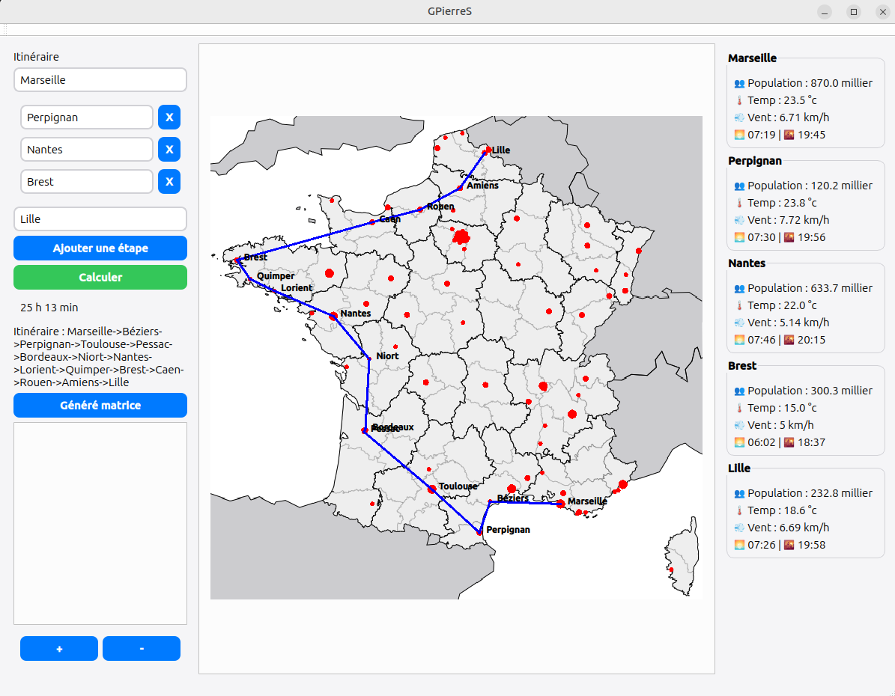
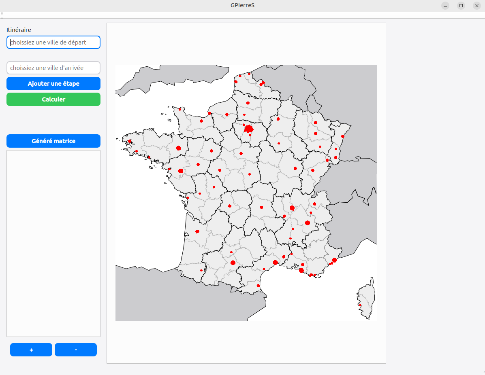
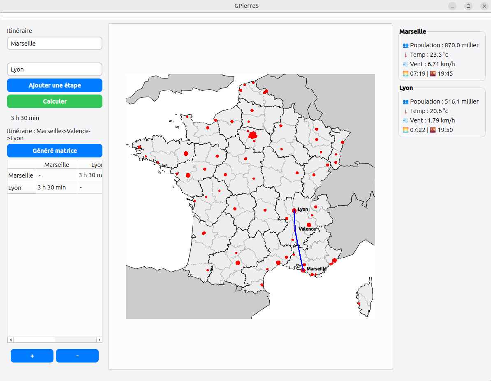

# GpierreS

Application GPS de bureau en C++ / Qt 6 : plus court chemin entre les 100 plus
grandes villes de France, étapes à volonté, matrice des temps de trajet et météo
en direct de chaque ville traversée.




## Contexte

Projet de cours du BUT Informatique (IUT d'Arles), réalisé seul, à partir de deux
fichiers CSV fournis : les informations des villes et les temps de trajet entre
elles.

## Fonctionnalités

- **Carte de France** : les villes sont placées sur la carte d'après leur latitude
  et leur longitude, avec un zoom avant / arrière
- **Plus court chemin** : l'algorithme de **Floyd-Warshall** calcule une fois pour
  toutes les temps minimaux entre chaque paire de villes, et une matrice des
  prédécesseurs permet de reconstruire le trajet, qui est ensuite tracé sur la
  carte avec sa durée en heures et minutes
- **Étapes** : on ajoute autant de villes intermédiaires que l'on veut (et on les
  retire d'un clic) ; le trajet est calculé segment par segment
- **Matrice des temps** : tableau des durées de trajet entre les villes choisies
- **Infos de chaque ville du trajet** : population, et météo en direct via l'API
  OpenWeatherMap (température, vent, lever et coucher du soleil), dont la réponse
  JSON est lue en C++
- Saisie des villes avec autocomplétion

| Carte des villes | Matrice des temps |
|---|---|
|  |  |

## Lancer le projet

Prérequis : Qt 6 (modules Widgets et Network) et Qt Creator.

1. Créer une clé gratuite sur [openweathermap.org](https://openweathermap.org/api)
   et la mettre dans la variable d'environnement `OPENWEATHER_API_KEY` (dans Qt
   Creator : Projets > Exécuter > Environnement). La clé n'est jamais écrite
   dans le code ; sans elle, l'itinéraire fonctionne mais la météo ne se charge pas.
2. Ouvrir `GPS.pro`, et régler le répertoire de travail sur le dossier du projet
   (Projets > Exécuter > Répertoire de travail) : les fichiers CSV et la carte sont
   lus en chemin relatif.
3. Compiler et lancer.

## Organisation du dépôt

```
GPS.pro               projet Qt
main.cpp
mainwindow.*          interface, calcul d'itinéraire, tracé, étapes, matrice
floyd_warshall.*      plus courts chemins entre toutes les paires de villes
lecturecsv.*          lecture de villes.csv et temps.csv
ville.*               une ville (id, nom, coordonnées, population)
meteo.*               appel à l'API météo et lecture du JSON
villes.csv            les 100 villes (fourni)
temps.csv             temps de trajet entre villes (fourni)
images/               fond de carte
docs/screenshots/     captures d'écran
```
